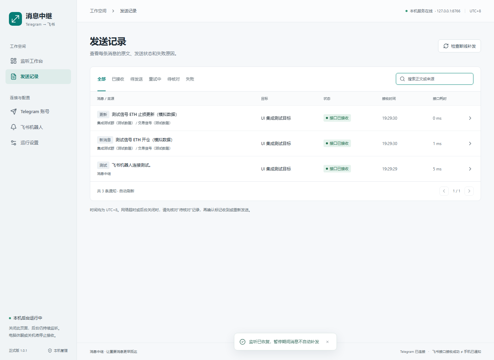

# Message · Telegram → 飞书消息中继

**正式版 1.0.1** · 中文可视化管理 · Windows 本地运行 · Linux 服务器常驻

Message 使用你自己的 Telegram 账号监听已加入的群组、频道和群话题，将符合规则的消息推送到指定的飞书群自定义机器人。在网页中选择监听来源、切换消息编辑同步、配置关键词并查看发送结果，无需修改代码。



以上为隔离集成测试中的模拟数据截图，不含真实账号、Webhook 或消息；测试耗时不代表实际网络性能。

```text
Telegram 群组 / 频道 / 话题
             ↓
Message 后台：监听 → 规则过滤 → SQLite 队列 → 飞书 Webhook
             ↓
飞书群接收通知，你在手机或电脑上查看
```

关闭管理网页不会停止后台；**运行后台的电脑关机、休眠或断网，会中断实时转发**。个人电脑关机后仍需接收消息时，请将后台部署到长期在线的服务器。GitHub 用于保存代码，发布仓库不会自动托管监听后台。

## 目录

- [功能与边界](#功能与边界)
- [运行环境](#运行环境)
- [Windows 安装与启动](#windows-安装与启动)
- [首次配置与使用](#首次配置与使用)
- [日常管理](#日常管理)
- [Linux 服务器部署](#linux-服务器部署)
- [从本机迁移到服务器](#从本机迁移到服务器)
- [更新与备份](#更新与备份)
- [常见问题](#常见问题)
- [开发与验证](#开发与验证)
- [项目结构](#项目结构)

## 功能与边界

### 已实现

- 手机号、验证码、两步验证登录 Telegram，登录会话保存在后台设备上。
- 自动列出账号可访问的群组和频道；话题群支持整个群组或指定话题。
- 多监听任务、多飞书机器人，一个来源可分别推送到不同机器人。
- 新消息转发，**每个任务独立控制是否同步消息编辑**。
- 包含/排除关键词过滤，不区分英文大小写，排除规则优先。
- 显示可获取的发送人姓名或频道署名；原消息时间与转发时间分行显示，保留可用的原消息链接。
- 长文本拆分发送，按正文及附件内容版本去重。
- SQLite 持久化队列、断线恢复扫描、延迟补发标记、限流及可重试错误退避。
- 发送记录、正文查询、失败手动重试、结果未知时人工核对。
- Windows 启动/停止与登录后自动启动脚本；Linux systemd 服务示例。

### 当前不包含

- **图片、视频和附件文件本体上传**：目前转发文字/图片说明，显示“含图片，原文件未转发”等提示；文件本体需在 Telegram 查看。
- 自动交易、飞书加急、已发送通知撤回、Telegram 删除消息镜像。
- 绕过内容保护或还原匿名身份：受保护内容跳过，匿名消息仅展示 Telegram 提供的身份。
- 多 Telegram 账号并行、带账号鉴权的公网管理站点、打包好的 Windows EXE。
- 保证恢复全部历史消息、每个中间编辑版本，或保证手机弹窗。恢复受扫描窗口、权限与网络影响；飞书接口接收成功不等于手机必然弹出通知。

## 运行环境

| 项目 | 要求 |
|---|---|
| Python | 3.11 或更新版本，需可用的 `venv` 和 `pip` |
| Node.js | 22.12 或更新版本，推荐 24 LTS；只在安装/构建前端时需要 |
| Git | 克隆与更新时需要；也可下载源代码 ZIP |
| Telegram | 自己的 API ID/API Hash，及已加入目标来源的账号 |
| 飞书 | 可添加群自定义机器人的群聊与机器人的 Webhook |
| 网络 | 后台设备可访问 Telegram、飞书与依赖下载地址；必要时配置代理 |

依赖由 `requirements.lock.txt` 和 `frontend/package-lock.json` 固定。前端构建后由 Python 提供静态页面，日常后台运行无需 Node.js。

安装参考：[Python](https://www.python.org/downloads/)、[Node.js](https://nodejs.org/en/download)、[Git](https://git-scm.com/downloads)。安装后新开终端检查：

```powershell
python --version
node --version
npm --version
git --version
```

## Windows 安装与启动

### 1. 获取代码

```powershell
git clone https://github.com/Nagnip-xu/Message.git
cd Message
```

也可在仓库选择 **Code → Download ZIP**，解压到固定目录。移动项目后，自动启动快捷方式需重新安装。

### 2. 启动

双击根目录 **`Start.cmd`**，或运行：

```powershell
.\Start.cmd
```

首次启动会创建 `.venv`、安装 Python 依赖、安装前端依赖并构建，因此需要能下载依赖的网络。完成后打开：**http://127.0.0.1:8765/**。

已有后台运行时，脚本只打开现有页面，不重复启动。保留 `data` 即可保留配置、会话与历史。

只启动后台、不打开浏览器：

```powershell
powershell -NoProfile -ExecutionPolicy Bypass -File .\Start.ps1 -NoBrowser
```

### 3. 停止与自动启动

```powershell
# 安全停止后台
.\Stop.cmd

# 可选：安装当前 Windows 用户登录后的自动启动快捷方式
powershell -NoProfile -ExecutionPolicy Bypass -File .\scripts\install-autostart.ps1
```

取消自动启动：`Win + R` 输入 `shell:startup`，删除 `Telegram-Feishu-Relay.lnk`。该方式需要 Windows 用户先登录，不是无人登录即可启动的系统服务。只关闭网页不影响后台；电脑仍需保持开机、联网且不休眠。

## 首次配置与使用

**全新安装不含任何人的应用凭证、登录状态或飞书机器人，需自行完成下列配置。**

### 第一步：填写 Telegram 应用配置

1. 登录 [Telegram 应用管理](https://my.telegram.org/apps)，获取自己的 `api_id` 与 `api_hash`。
2. 打开 **运行设置**，填写 **API ID** 与 **API Hash**。
3. 必要时填写后台设备实际可用的代理，例如 `socks5://127.0.0.1:7890` 或 `http://127.0.0.1:7890`；不需要则留空。端口仅为格式示例。
4. 保持补发扫描上限默认 500 条，或选择 100–5000 条。
5. 点击 **保存并重新连接**。

应用凭证不等于账号登录。程序不复用 Telegram 桌面客户端的会话，也不会自动读取它的代理配置。

### 第二步：登录 Telegram

1. 进入 **Telegram 账号**，输入带国家区号的手机号。
2. 点击 **获取验证码**，到已登录的 Telegram 客户端或短信中查找；发送渠道由 Telegram 决定。
3. 输入验证码；开启两步验证时，再输入 Telegram 密码。
4. 页面显示已登录/已连接后，即可选择该账号可访问的来源。

正常重启会读取已保存的会话。退出账号会暂停现有任务；切换账号后，请核对来源再手动恢复。

### 第三步：创建飞书群自定义机器人

1. 在**飞书电脑客户端**打开接收通知的群聊。
2. 进入 **群设置 → 群机器人 → 添加机器人 → 自定义机器人**，填写名称与说明。移动端可能只列出应用机器人；电脑端也没有入口时，请确认群类型与组织管理策略。
3. 复制 HTTPS Webhook，格式为 `https://open.feishu.cn/open-apis/bot/v2/hook/...`。
4. 开启 **签名校验** 时同时保存签名密钥；配置了关键词/IP 白名单时，内容与后台出口 IP 也需符合规则。

本项目使用**群自定义机器人 Webhook**，无需先创建企业应用。应用机器人的 App ID/App Secret 不能直接填入这里。

参考：[飞书自定义机器人使用指南](https://open.feishu.cn/document/client-docs/bot-v3/add-custom-bot)。

### 第四步：在 Message 添加飞书机器人

1. 进入 **飞书机器人 → 添加机器人**。
2. 填写便于识别的名称，粘贴完整 **Webhook 地址**。
3. 飞书开启签名校验时填写相同的 **签名密钥**；未开启则留空。
4. 保存后点击机器人的 **测试**。
5. 在 **发送记录** 和飞书群核实结果，再检查手机群免打扰、系统通知与声音。

连接测试包含“飞书机器人连接测试”，来源名为“消息中继”。若设置关键词，请确保能匹配测试及实际通知。

### 第五步：创建监听任务

1. **监听工作台 → 新建监听任务**。
2. 搜索并选择已加入的群组/频道；列表不全时点击刷新。
3. 若为话题群，在 **监听范围** 选择整个群组或具体话题。
4. 选择 **发送到飞书机器人**，填写任务名称。
5. 设置规则后，点击 **创建并开始监听**。

| 规则 | 行为 |
|---|---|
| 同步消息编辑 | 原文修改后另发“消息更新”；只想看新消息就关闭，每个任务独立设置 |
| 检查断线补发 | 重连与运行中扫描近期可恢复消息，不是回放所有历史 |
| 包含关键词 | 逗号/换行分隔，命中任意一个即可；留空不限制 |
| 排除关键词 | 命中任意一个跳过，优先于包含规则 |
| 延迟标记阈值 | 超过时长标记“延迟补发”，不会因此丢弃正文 |

首次启用从当前消息位置开始，不批量发送历史。来源中**别人和自己发送的消息都会监听**，仍遵守话题/关键词/内容保护规则。更换来源或目标时，请新建任务并停用旧任务。

### 第六步：验证和调整

先选一个你能发消息的测试群，发送文字确认飞书收到，再修改文字验证编辑同步开关。接通后再添加真正关注的来源。

关闭编辑同步：**监听工作台 → 任务右侧铅笔 → 关闭“同步消息编辑” → 保存规则**。不必关闭整个任务或重启；保存前已经入队的通知仍可能发出。

通知示例（虚构内容）：

```text
【新消息】示例群 / 信号话题

这是一条用于验证转发的示例消息。

发送人：示例成员
原消息：11-03 20:11:09 (UTC+8)
转发：11-03 20:11:10 (UTC+8)
在 Telegram 查看原消息
```

## 日常管理

| 操作/状态 | 说明 |
|---|---|
| 暂停任务 | 停止接收/发送该任务，旧队列保留；已发出的 HTTP 请求可能完成 |
| 恢复任务 | 继续旧队列，从恢复时的位置监听；暂停期间消息不自动补发 |
| 停用机器人 | 通知保留在队列，启用后继续发送 |
| 删除任务 | 取消待发送/重试通知，保留历史；进行中的请求可能完成 |
| 接口已接收 | 飞书接口成功，或待核对记录经用户确认收到；不保证手机弹窗 |
| 等待重试 | 明确可重试的连接/限流错误，退避重试，单轮最多尝试 8 次 |
| 待核对 | 超时、服务端错误、无效响应或停止时结果未知，暂停自动重发 |
| 发送失败 | 查看原因，修正后可手动重试 |
| 恢复窗口超限 | 可能有未恢复消息，到原群核对，必要时提高扫描上限 |

**待核对**：先按正文、来源和时间去飞书群核实；已收到则选 **已在飞书确认收到**，未收到再选 **未收到，重新发送**。

**发送记录** 支持搜索、状态筛选、详情与重试；**运行设置 → 导出诊断信息** 提供日志与统计，不包含 API Hash、Webhook 或正文。时间统一为 UTC+8；接口耗时仅为 HTTP 响应时间，不是端到端通知延迟。

## Linux 服务器部署

以下以 **Ubuntu 24.04 LTS + systemd** 为例。服务器需长期在线并能访问 Telegram、飞书和依赖下载地址，不能依赖个人电脑上的代理。

后台只监听 `127.0.0.1:8765`，通过 **SSH 隧道** 管理；无需开放 8765 公网端口。管理界面没有独立用户鉴权，不适合直接暴露公网。以下 `ubuntu@SERVER_IP` 请替换为自己的 SSH 用户和服务器地址。

### 1. 在电脑构建前端并上传

在本机项目根目录运行：

```powershell
npm --prefix frontend ci
npm --prefix frontend run build
python -m tarfile -c message-frontend.tar.gz frontend/dist
scp .\message-frontend.tar.gz ubuntu@SERVER_IP:/tmp/message-frontend.tar.gz
```

只上传静态构建结果，不上传本机 `.venv` 或 `node_modules`；采用此方式，服务器无需安装 Node.js。

### 2. 在服务器安装后端和静态页面

SSH 登录服务器，在 Linux 终端执行：

```bash
sudo apt update
sudo apt install -y python3 python3-venv python3-pip git ca-certificates tar
python3 --version

sudo git clone https://github.com/Nagnip-xu/Message.git /opt/Message
sudo python3 -m venv /opt/Message/.venv
sudo /opt/Message/.venv/bin/python -m pip install -r /opt/Message/requirements.lock.txt
sudo tar -xzf /tmp/message-frontend.tar.gz -C /opt/Message
test -f /opt/Message/frontend/dist/index.html
```

服务器已安装兼容的 Node.js 时，也可以在 `/opt/Message/frontend` 运行 `npm ci` 和 `npm run build`，省略本机打包上传步骤。

**Alibaba Cloud Linux 3**：将上面的 `apt` 安装命令替换为 `sudo dnf install -y python3.11 python3.11-pip git ca-certificates tar`。系统自带的 Python 可能是 3.6，不满足本项目要求；克隆仓库后，使用 `sudo python3.11 -m venv /opt/Message/.venv` 创建虚拟环境。后续依赖安装、静态页面上传和 systemd 配置步骤相同，无需替换系统 Python。本项目已在 Alibaba Cloud Linux 3 + Python 3.11 环境验证。

中国内地地域的服务器可能无法直连 Telegram。请先验证 Telegram 连接；需要代理时，在程序的运行设置中填写服务器可使用的 HTTP/SOCKS5 代理。个人电脑的本地代理不会随项目部署到服务器，依赖电脑持续在线的代理也无法满足关机后继续监听的需求。

### 3. 安装常驻服务

首次安装时创建专用用户，安装仓库提供的服务文件：

```bash
sudo useradd --system --user-group --home-dir /var/lib/message-relay --no-create-home --shell /usr/sbin/nologin message-relay
sudo cp /opt/Message/deploy/message-relay.service /etc/systemd/system/message-relay.service
sudo systemctl daemon-reload
sudo systemctl enable --now message-relay
sudo systemctl status message-relay --no-pager
curl --fail http://127.0.0.1:8765/api/health
```

已有同名用户时跳过 `useradd`，更新时无需重复创建。健康接口应返回 `"ok": true` 与 `"version": "1.0.1"`。

服务使用程序目录 `/opt/Message`、Python `/opt/Message/.venv/bin/python` 和数据目录 `/var/lib/message-relay`（通过 `RELAY_DATA_DIR` 设置，首次由 systemd 创建）。开机自动运行，异常退出尝试重启，运行日志交给 journal。

路径改变时同步修改服务文件。**同一数据目录只运行一个后台**；使用 `run_server.py` 保留单实例锁，不要另起多 worker 的 Uvicorn。

### 4. 从电脑打开服务器管理页

在自己的电脑另开终端，保持以下命令运行：

```powershell
ssh -N -o ExitOnForwardFailure=yes -o ServerAliveInterval=30 -L 18765:127.0.0.1:8765 ubuntu@SERVER_IP
```

浏览器访问 **http://127.0.0.1:18765/**。18765 是电脑端隧道端口，可与本机版本的 8765 区分；占用时可更换 `-L` 最前面的端口。

按照[首次配置与使用](#首次配置与使用)填写服务器网络设置、登录 Telegram、添加机器人与任务。完成后关闭网页或 SSH 隧道只关闭管理连接，服务器后台仍运行，个人电脑关机也不影响转发到飞书。

### 5. 日常服务器命令

```bash
# 状态和最近日志
sudo systemctl status message-relay --no-pager
sudo journalctl -u message-relay -n 100 --no-pager

# 持续看日志，Ctrl+C 只退出日志查看
sudo journalctl -u message-relay -f

# 停止 / 启动 / 重启
sudo systemctl stop message-relay
sudo systemctl start message-relay
sudo systemctl restart message-relay

# 取消开机启动并停止
sudo systemctl disable --now message-relay
```

Windows 服务器可按本地方式部署，但自动启动脚本需要 Windows 用户先登录；需要无人登录即可常驻时，可选 Linux systemd 方式。

## 从本机迁移到服务器

**推荐在服务器重新登录和配置**：先停本机后台，再按首次配置步骤在服务器登录 Telegram、添加机器人与任务，发送测试消息验证。GitHub 仓库不携带你的登录状态。

必须保留任务、队列和历史时，可迁移完整数据目录：

1. 停止本机后台和服务器服务；不要同时运行旧会话。
2. 备份服务器已有数据，避免覆盖后无法恢复。
3. 本机根目录打包上传：

   ```powershell
   .\Stop.cmd
   python -m tarfile -c message-data.tar.gz data
   scp .\message-data.tar.gz ubuntu@SERVER_IP:/tmp/message-data.tar.gz
   ```

4. 服务器确认服务停止，再将归档中的 `data/` 内容写入服务数据目录：

   ```bash
   sudo systemctl stop message-relay
   sudo install -d -m 700 -o message-relay -g message-relay /var/lib/message-relay
   sudo tar --strip-components=1 -xzf /tmp/message-data.tar.gz -C /var/lib/message-relay
   sudo chown -R message-relay:message-relay /var/lib/message-relay
   sudo systemctl start message-relay
   ```

5. 经 SSH 隧道进入 **运行设置**，修改原本指向个人电脑的代理，或清空使用服务器直连。
6. 核对连接、任务开关和测试消息，确认后保持本机后台停止。

归档含会话、机器人和历史，不要上传 GitHub。妥善保存私有备份，移除不再需要的临时副本。不要在多台机器同时运行同一份 Telegram 会话。

## 更新与备份

### Windows 更新

```powershell
.\Stop.cmd
# 先将整个 data 目录备份到项目外的私有位置
git pull --ff-only
powershell -NoProfile -ExecutionPolicy Bypass -File .\scripts\update.ps1
.\Start.cmd
```

ZIP 安装没有 Git 历史，下载新版源码后，将私有 `data` 放入新版目录并安装依赖；不要用空数据覆盖旧数据。

### Linux 更新

先在电脑构建**与服务器将要更新到的同一版本**前端，按部署步骤重新上传 `message-frontend.tar.gz`，再在服务器执行：

```bash
sudo systemctl stop message-relay
# 先按下文备份 /var/lib/message-relay
sudo git -C /opt/Message pull --ff-only
sudo /opt/Message/.venv/bin/python -m pip install -r /opt/Message/requirements.lock.txt
sudo tar -xzf /tmp/message-frontend.tar.gz -C /opt/Message
sudo cp /opt/Message/deploy/message-relay.service /etc/systemd/system/message-relay.service
sudo systemctl daemon-reload
sudo systemctl start message-relay
curl --fail http://127.0.0.1:8765/api/health
```

### 数据备份与恢复

Windows 数据默认在项目 `data/`，systemd 示例使用 `/var/lib/message-relay/`。**先停止后台，再复制/打包整个目录**，保留数据库相关文件和 Telegram 会话。诊断导出仅含日志与统计，不能恢复配置。

Linux 备份示例：

```bash
sudo systemctl stop message-relay
sudo install -d -m 700 /var/backups/message-relay
sudo tar -czf /var/backups/message-relay/data-$(date +%Y%m%d-%H%M%S).tar.gz -C /var/lib message-relay
sudo systemctl start message-relay
```

恢复时停服务，备份当前数据，再将归档里的 `message-relay/` 恢复到 `/var/lib/`，设置所有权为 `message-relay:message-relay`，然后启动核对。

## 常见问题

### 网页关闭后还能监听吗？电脑关机呢？

只关闭网页可以继续。后台设备关机、休眠或断网时无法实时接收；重启只能尽力恢复扫描范围内的消息。全天候运行请选择长期在线的服务器。

### 能监听别人发的消息吗？

能。所选来源里别人和自己的消息都在范围内，不会自动监听未创建任务的其他会话。账号必须能访问来源，受保护内容会跳过。

### 为什么没有新消息也出现“消息更新”？

作者修改了原消息，例如持续刷新持仓。编辑任务规则，关闭 **同步消息编辑** 并保存，新消息继续转发。

### 图片为什么没有出现在飞书？

1.0.1 仅转发文字、图片/附件提示与原链接，不下载上传文件本体。Webhook 不提供图片上传所需的应用凭证；本版没有接入应用机器人的上传流程。

### Telegram 连接超时或来源列表为空？

检查后台设备的网络、代理进程和地址，再确认登录状态、群成员身份及刷新列表。服务器里的 `127.0.0.1` 指服务器本身，不是个人电脑。

### 飞书测试失败？

到 **发送记录** 查看原因，核对 Webhook、机器人启用状态、签名、关键词/IP 规则与系统时间。待核对记录先去群里核实，不要连续点重发。

### 安装失败或提示前端未构建？

确认 Python/Node/npm 版本、PATH 和依赖下载网络。Windows 可运行 `scripts/update.ps1` 补装；Linux 检查 `/opt/Message/frontend/dist/index.html` 是否存在。端口占用时不要另起第二个实例。

### 能直接把 8765 开到公网吗？

本版只绑定回环地址，管理页无独立账号鉴权且校验来源，不能直接作为公网管理站点。请使用 SSH 隧道；公网域名/手机直接管理需要另行设计认证与访问控制。

## 开发与验证

### 后端

```powershell
python -m venv .venv
.\.venv\Scripts\python.exe -m pip install -r requirements.lock.txt
.\.venv\Scripts\python.exe -m pytest -q
.\.venv\Scripts\python.exe run_server.py
```

Linux Python 路径为 `.venv/bin/python`。`RELAY_DATA_DIR` 可指定数据目录，默认是根目录 `data/`。测试新实例请用独立目录，避免干扰真实会话/队列。

### 前端

```powershell
cd frontend
npm ci
npm run dev
# 生产构建：npm run build
```

Vite 将 `/api` 代理到本机 8765，生产环境由 FastAPI 同时提供静态页面。

### 浏览器集成测试

使用独立数据目录、模拟 Telegram 和内存 HTTP 传输，不使用真实账号，不发送外部消息。不要把测试服务当正式服务部署。

```powershell
# 终端一，在项目根目录保持运行
.\.venv\Scripts\python.exe -m uvicorn tests.ui_server:app --host 127.0.0.1 --port 8766 --log-level warning

# 终端二
cd frontend
npm ci
npm run build
npx playwright install chromium
node scripts/integration.mjs
```

覆盖机器人配置、任务/话题、新消息/编辑、去重、规则、暂停恢复、历史查询和移动布局。`scripts/capture.mjs` 读取本机正式服务截图，可能含真实配置，产物在被 Git 忽略的 `artifacts/`，不作为公开截图提交。

## 项目结构

```text
relay/                       后端、Telegram 监听、飞书发送、配置与 SQLite 队列
frontend/src/                React / TypeScript 中文管理界面
frontend/scripts/            浏览器集成测试和本机截图脚本
tests/                       后端测试与隔离 UI 测试服务
deploy/message-relay.service Linux systemd 服务示例
.github/workflows/ci.yml     Windows / Linux 后端测试与前端构建
Start.cmd / Stop.cmd         Windows 启动 / 安全停止
scripts/                    依赖更新与登录后自动启动
run_server.py                回环监听、单实例锁、单 worker 入口
requirements.lock.txt        Python 精确依赖
data/                       私有配置、会话、机器人、队列、历史和本机日志
```

`data/`、`.venv/`、`node_modules/`、构建产物、日志、数据库、会话和本机截图均由 Git 忽略。源码仓库不附带任何可用的账号或机器人配置。
